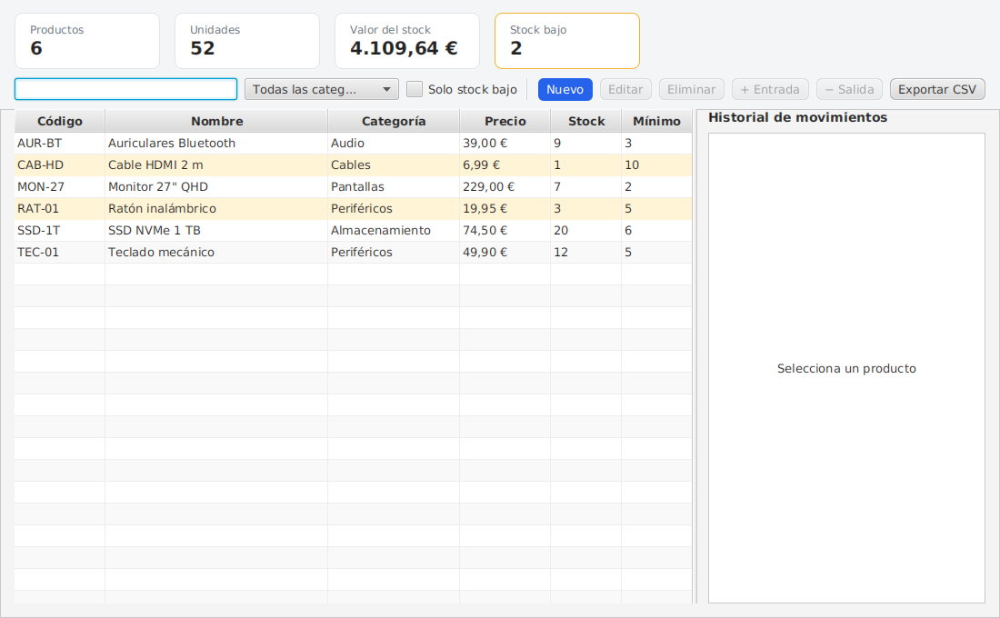

# 📦 Inventario JavaFX

Aplicación de escritorio para llevar el inventario de una tienda: productos, entradas y salidas de stock, avisos de stock bajo y exportación a CSV. Proyecto de 2º de DAM (módulos de Desarrollo de Interfaces y Acceso a Datos).



## Tecnologías

- Java 21 con módulos (`module-info.java`)
- JavaFX 21 con FXML y CSS
- SQLite con JDBC puro (sentencias preparadas, sin ORM)
- JUnit 5
- Maven y GitHub Actions

## Funcionalidades

- Tabla de productos ordenable, con búsqueda en vivo, filtro por categoría y filtro de stock bajo
- Tarjetas de resumen: número de productos, unidades y valor total del stock
- Filas resaltadas cuando el stock está en el mínimo o por debajo
- Alta y edición en un diálogo que valida los datos antes de cerrarse
- Entradas y salidas de stock con nota, guardadas en un historial por producto
- **Transacciones**: el cambio de stock y su movimiento se guardan juntos o no se guarda ninguno, y no se permite dejar el stock en negativo
- Exportación a CSV (separador `;`, compatible con Excel en español)

## Arquitectura

```
ui (FXML + controladores)  →  servicio (reglas y transacciones)  →  datos (DAO JDBC)  →  SQLite
                     modelo (records inmutables: Producto, Movimiento)
```

La base de datos se crea sola en `~/.inventario-javafx/inventario.db` y la primera vez se rellena con productos de ejemplo.

## Cómo ejecutarlo

Necesitas Java 21. Maven ya viene incluido con el wrapper:

```bash
./mvnw javafx:run
```

En Windows: `mvnw.cmd javafx:run`

## Tests

```bash
./mvnw test
```

Los tests usan SQLite en memoria y cubren el DAO, las transacciones (una salida sin stock no deja rastro), el resumen y la exportación CSV.

## Autor

Samuel ([@Samuelypsv](https://github.com/Samuelypsv)), estudiante de Desarrollo de Aplicaciones Multiplataforma.
